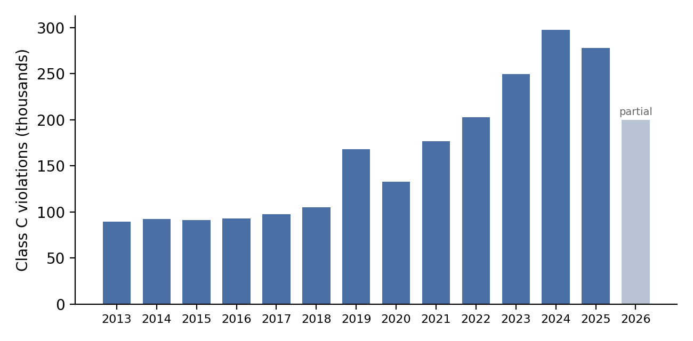
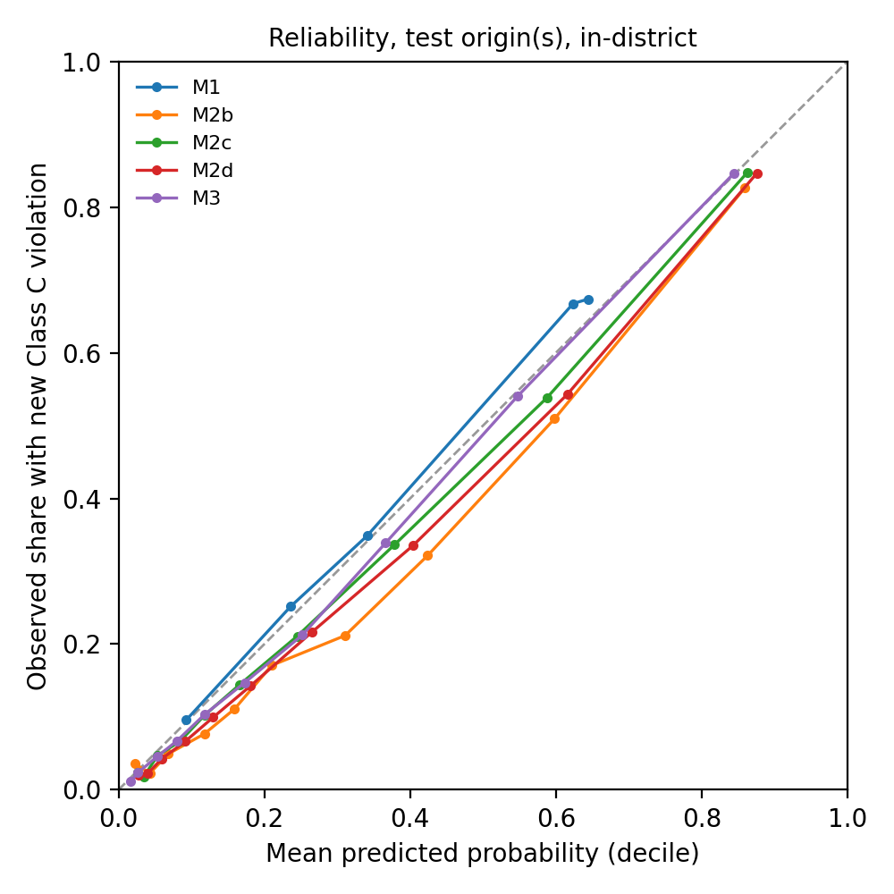
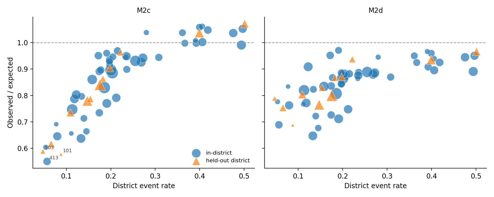
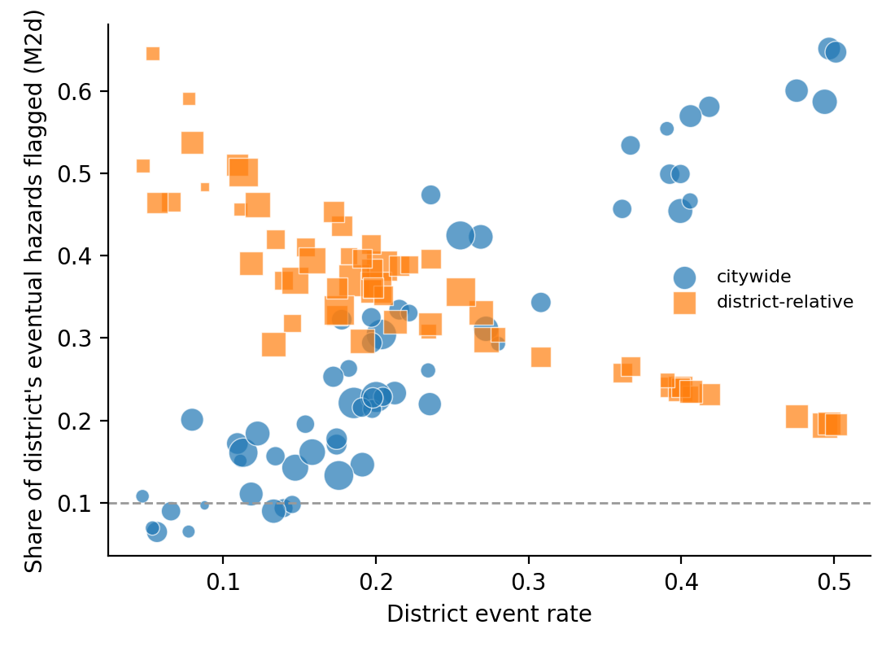
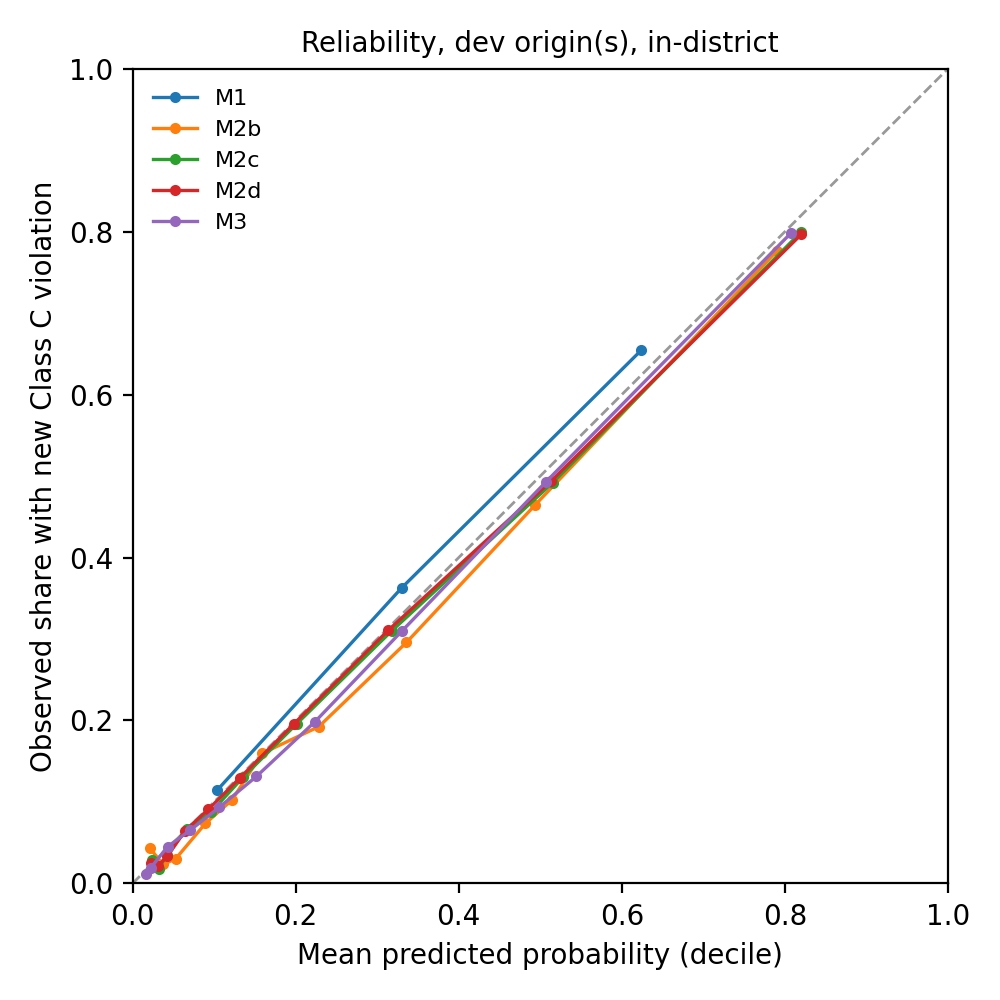
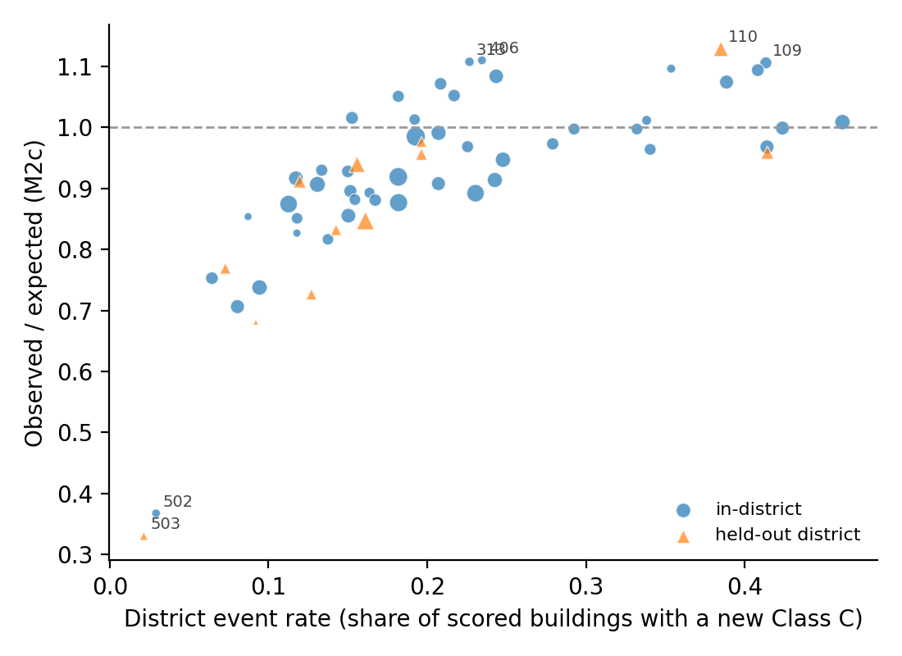

# Before Signing the Lease: Predictive Value and Spatial Reliability of Housing Maintenance Records in New York City

**Author.** Hsuan Lo, DDes (Harvard University). Independent Researcher. Correspondence: hsuanlo@alumni.harvard.edu

**Status.** Working paper v0.3, 6 October 2026. The model specification was frozen at 05:37 UTC on 6 October 2026 (`docs/FROZEN_SPEC.json`, git commit `8db7aa6`), and the 2024–2025 test origins were then scored once. Section 7 reports those test results. Development-stage results (1 January 2023 origin) that informed the specification are in Appendix D. Analyses labelled *secondary* were not pre-specified.

---

## Abstract

*(Working-paper abstract. The 250-word AAG version is in `paper/abstract_aag2027.md`.)*

A renter about to sign a lease in New York City can look up a building's housing-code record, but a list of past violations does not say whether hazards are likely to recur. We ask whether the timing, type and repetition of public maintenance records predict a new immediately hazardous (Class C) violation in the next six months better than a simple count does, and where in the city that predictive ability holds. Using every Class C violation and housing-maintenance complaint recorded by the Department of Housing Preservation and Development since 2017, we build a building-by-half-year panel and compare three layers of increasing complexity: a smoothed count baseline, nested logistic regressions that add event history, complaints and finally district context, and gradient boosting. The design is built against leakage. Features use only records approved at least 30 days before each prediction date. Today's case status and building attributes are excluded. The specification was frozen before it was scored on 2024–2025. A fifth of community districts is withheld from all fitting so that spatial transfer can be separated from temporal drift. We evaluate probabilities, not only rankings, with the Brier score, calibration and precision at a fixed 10% review budget. On the 2024–2025 test, event history and complaints together reduced the Brier score by 13% relative to a count-only model, and gradient boosting added less than 1%. Among the top-scored 10% of buildings, 85% received a Class C violation within six months, against 78% when ranked by violation count alone. Ranking held up over time but calibration did not. As recorded violations per building rose by 40% while the event rate stayed flat, predicted risk drifted to about a fifth above observed risk. A place-blind model over-predicted risk in low-hazard districts (district observed/expected ratio tracking district event rate, ρ = 0.92). District context features narrowed but did not remove this, and their development-stage benefit did not replicate. With a fixed 10% review budget, a citywide warning threshold left eight districts with fewer than one in ten eventual hazards flagged. Allocating the same budget within districts raised every district to at least 19%, at the cost of 15% of hazards found citywide. Recorded Class C violations more than tripled between 2015 and 2024, and the drift shows up directly in the forecasts' calibration. Finally, linking 3,885 active rental listings to the building register shows that only 59% can receive any record-based warning. Where records are sparse, a low score is an absence of evidence, and the paper treats that absence as a geographic finding about whose housing problems become visible to the state.

**Keywords:** housing quality, code enforcement, administrative data, predictive modeling, calibration, spatial transferability, rental information, New York City

---

## 1. Introduction

Rental search platforms tell a prospective tenant a great deal about the unit: rent, size, photographs, commute. They say almost nothing about whether the heat will work in January or whether the ceiling will leak again. That information exists in public records. New York City's Department of Housing Preservation and Development (HPD) publishes every housing-maintenance complaint it receives and every violation its inspectors issue, building by building. Tenant organizers and civic-technology tools already surface those records at the point of search (JustFix, n.d.). What a list of records cannot tell a renter is what to *expect*. Ten violations spread over eight years and ten violations in the last three months look identical as a count. They are not identical as a warning.

This paper asks a narrow question that a renter, a listing platform and a code-enforcement agency would all want answered. **Given what is publicly recorded about a building at a point in time, how well can we predict that it will receive a new immediately hazardous violation in the next six months, and where does that predictive ability fail?**

The question is easy to answer badly. Administrative housing records are generated by a process in which tenants must complain, inspectors must gain access and the agency must record what it finds. Each step varies across neighborhoods and over time (O'Brien, Sampson & Winship, 2015; Kontokosta & Hong, 2021). A model trained on those records can look accurate citywide while being systematically miscalibrated in places where problems are under-reported. Reported case status is today's status, not the status at the time of prediction, so naive feature construction leaks the future. Previous attempts to predict housing-code violations have produced both encouraging results (Robb et al., 2022) and an official pilot that the agency abandoned after the model failed to predict what inspectors found (The Lab @ DC, n.d.). Whether prediction works here is an empirical question, and the answer is allowed to be no.

We make three contributions.

1. **Incremental predictive value.** We compare nested models on identical rows and test whether event history (recency, burstiness versus repetition, problem type) and complaint signals add information beyond the count a renter could compute by eye. Gradient boosting has to beat logistic regression on the same inputs, out of time and out of place, before its complexity is accepted.
2. **Spatial reliability as an outcome.** We withhold a fifth of community districts from all model fitting. Comparing those districts with the rest at the same prediction date separates spatial transfer from temporal drift. We report calibration (whether a predicted 20% means 20%) by district, not only citywide discrimination. We then test how much of the district-level error is removed by giving the model place information known at the prediction date.
3. **Coverage and abstention.** Linking 3,885 active rental listings to HPD buildings, we measure the share of the market for which a record-based warning can be offered at all. We argue that "no record" must be presented as missing evidence, not as safety.

These contributions fit the 2027 AAG theme on geographic methods, tools and techniques for knowledge and justice. The geographic object is not a risk map. It is the uneven reliability of a public-data tool across the city it claims to describe.

## 2. Background

### 2.1 Housing quality, health and information asymmetry

Housing conditions are a well-established determinant of health. Heat failures, leaks and mold, pests and lead paint are linked to respiratory, injury and developmental harms (Krieger & Higgins, 2002). In rental markets those conditions are classic hidden attributes. The landlord knows the building's history and the prospective tenant does not, which is the structure Akerlof (1970) described for used cars. Code violations are capitalized into prices and rents (Bartram, 2019), but capitalization does not tell an individual renter about a particular building. Disclosure tools that put violation histories in front of tenants are a response to this asymmetry. Their usefulness depends on whether a record is a guide to future conditions, and that is the question we test.

### 2.2 Predicting housing-code violations

Machine-learning prioritization of housing inspections has a short and mixed record. Using 1,611 proactively inspected properties in Chelsea, Massachusetts, Robb et al. (2022) estimate that a model built on integrated city data could identify code violations at 1.8 times the rate of inspector-informed selection. In Washington, DC, The Lab @ DC built a model from permit, tax, census and prior-violation data. When the agency inspected 260 high-scoring properties, violations were found in 24% of exterior inspections, against roughly 50% in random inspections, and the agency did not adopt the model (The Lab @ DC, n.d.). The team suggested that a change in data-entry practice may have contributed. That account is exactly the kind of temporal drift a frozen, out-of-time evaluation is designed to expose. Both studies predict *inspection findings* for a targeting decision. We predict *future recorded hazards* for a disclosure decision, at the scale of a large city, and we evaluate where predictions are reliable.

### 2.3 Administrative records as measurement

Complaint and enforcement records are not neutral sensors. O'Brien, Sampson and Winship (2015) show how 311 records can be turned into neighborhood measures, provided their reliability is assessed explicitly. Kontokosta and Hong (2021) document socio-spatial differences in the propensity to complain and show that decisions trained on complaint data inherit them. For our problem, recorded hazards are a function of both underlying conditions and the visibility of those conditions to the state. A model can only learn the second. We therefore name our outcome *recorded* Class C violations throughout and treat district-level miscalibration as evidence about the recording process, not only about the model.

### 2.4 Out-of-time and out-of-place validation

Random cross-validation overstates performance when observations share temporal or spatial structure (Roberts et al., 2017). Predictions extrapolated beyond the environmental range of the training data need an explicit area of applicability (Meyer & Pebesma, 2021). In clinical prediction, calibration has been called the "Achilles heel" of predictive analytics. Calibration is the agreement between predicted and observed risk, and a model can rank well while being miscalibrated in a new setting (Van Calster et al., 2019). Leakage through features unavailable at prediction time is a pervasive source of inflated results (Kaufman et al., 2012). Our design borrows from all four literatures: a frozen model, a temporal test, a spatial hold-out, calibration as a primary outcome, and an information cutoff enforced in code.

## 3. Setting and data

### 3.1 Housing-code enforcement in New York City

HPD enforces the Housing Maintenance Code in multiple dwellings. Tenants report conditions through 311, and HPD records each report as a *complaint* containing one or more *problems*. An inspector may then visit and issue violations. Violations are classed by severity. Class A is non-hazardous, Class B hazardous, and Class C immediately hazardous. Class C covers conditions such as lack of heat or hot water, lead-based paint hazards, rodents, and missing window guards or detectors, and carries the shortest correction period. Each violation records an inspection date (when the condition was observed) and an approval date (when it entered the record), along with the Housing Maintenance Code order number that identifies the condition.

### 3.2 Datasets

All public data are drawn from NYC Open Data through its API and retrieved on 6 October 2026 (Table 1).

**Table 1. Data sources.**

| Source | Records used | Role |
|---|---|---|
| HPD Housing Maintenance Code Violations (`wvxf-dwi5`) | Class C, inspected 2017-01-01 to 2026-10-04: 1,908,632 violations, 85,012 buildings | Features; outcome |
| HPD Complaints and Problems (`ygpa-z7cr`) | 2017–2026, aggregated to building × month × category × type: 3,689,419 cells | Features |
| Buildings Subject to HPD Jurisdiction (`kj4p-ruqc`) | 380,119 buildings | Community district; address; BBL |
| RentCast active rental listings (licensed) | 3,885 NYC listings, August 2026 | Coverage application (RQ5) |

Complaints and violations both carry HPD's building identifier, so they join without geocoding. The 126 Class C order numbers are mapped to eleven problem types by ordered keyword rules applied to a representative description of each order (Appendix B). Pests (22.6%), doors and egress (20.3%), heat and hot water (15.9%), structural surfaces (14.0%) and lead paint (8.8%) account for most Class C records since 2017.

### 3.3 Enforcement drift

The volume of recorded Class C violations rose from about 91,000 in 2015 to 298,000 in 2024 (Figure 1). Housing conditions did not deteriorate threefold over that decade. The increase reflects a mix of policy, inspection practice and reporting behavior. For a forecasting study, it means the base rate a model learns from 2020–2022 will not be the base rate of 2024–2025. A model can rank buildings correctly and still be systematically wrong about the level of risk. This is why we treat calibration as a primary outcome and estimate a recalibration on a separate origin before testing.

## 4. Study design

### 4.1 Unit, origins and outcome

The unit of analysis is a building at a prediction origin *t*. Origins are 1 January and 1 July. The outcome is

$$Y_{it} = \mathbb{1}\left[\text{building } i \text{ receives} \ge 1 \text{ Class C violation with inspection date in } [t,\, t + 6\text{ months})\right].$$

For example, at *t* = 1 January 2024 the outcome window runs to 30 June 2024. A violation inspected on 15 March 2024 is part of the outcome and never part of the features.

### 4.2 Information set

A record is *known at t* only if it could have been seen on that date. Violations enter the features only if their approval date is at least 30 days before *t*. Complaint months enter only if the whole month ended at least 30 days before *t*. Two fields are excluded because they describe today rather than *t*. The first is a violation's current status: a violation open in 2021 and closed in 2023 shows as closed today. The second is building attributes from the current register (units, stories, management program). Dismissed violations are kept in the main analysis, because whether a violation would later be dismissed was not known at *t*. A sensitivity analysis drops them.

### 4.3 Scope

A building is in scope at *t* if it had any Class C violation or HPD complaint in the 24 months before the information cutoff. Buildings outside that set are not scored. In a product, they would be labelled "insufficient record", not "low risk". The size and geography of the out-of-scope set is itself reported (Section 7.5).

### 4.4 Features

**Table 2. Feature groups (full dictionary in Appendix A).**

| Group | Features | Used in |
|---|---|---|
| Counts | Class C in last 365 and 90 days | M1 (365 only), M2a+ |
| Season | July-origin indicator | all |
| Timing and repetition | days since last Class C; 2-year count; distinct inspection days and months in the last year; trend; history length | M2b+ |
| Severity and type | rent-impairing count; counts by 11 problem types (last year) | M2b+ |
| Complaints | complaints in 90/365/730 days; emergency problems; distinct complaint months; complaint trend; counts in 8 major categories | M2c, M2d, M3 |
| District context | share of the district's in-scope buildings with a Class C in the last 365 / 90 days; district mean log(1 + past-year complaints). All computed from features at *t*, never outcomes | M2d |

Trend is a difference in daily event rates between the last 90 days and the preceding 275, $C^{90}/90 - (C^{365} - C^{90})/275$. With nine events in each period, the last 90 days run at about three times the earlier daily rate and trend ≈ +0.067 per day. A raw difference $C^{90} - C^{365}$ would read this building as flat or declining.

## 5. Models

The three layers are *compared*, not chained. No model consumes another's output. They are fit in order of complexity, and each must improve on the previous one on the same rows.

**M1, count baseline.** Buildings are binned by past-year Class C count (0, 1, 2–4, 5+) and season. The predicted probability is the bin's training event rate, shrunk toward the overall rate $\bar p$:
$$\hat p^{(1)}_{it} = \frac{E_g + \kappa\bar p}{N_g + \kappa},\qquad \kappa = 20.$$
A bin with 100 observations and 20 events, with $\bar p$ = 10%, gives $(20+2)/120 = 18.3\%$. A ranking-only variant (M1r) sorts by the raw count and corresponds to a renter or inspector reading the record directly.

**M2, logistic regression.** Three nested specifications use the same estimator,
$$\hat p^{(2)}_{it} = \sigma(\eta_{it}),\quad \eta_{it} = \alpha + \beta_1\log(1+C^{365}_{it}) + \beta_2\log(1+C^{90}_{it}) + \theta^\top Z_{it} + \gamma\,\text{Jul}_t,$$
where $Z$ is empty in M2a, adds timing, repetition and type in M2b, adds complaints in M2c, and adds district context in M2d. Counts enter as $\log(1+x)$ and all inputs are standardized. The L2 penalty is selected on the tuning origin. Coefficients are conditional associations, not effects.

**M3, gradient boosting.** A histogram gradient-boosted tree ensemble,
$$F_M(X) = F_0 + \nu\sum_{m=1}^{M} f_m(X),\qquad \hat p^{(3)} = \sigma(F_M(X)),$$
is fit on the M2c inputs, with early stopping and a small grid over learning rate and leaf count selected on the tuning origin. M3 can represent interactions such as "recent complaints matter only when the same problem recurs across months" without their being specified. If it does not beat M2c out of time and out of place, M2c is preferred.

**M2d, district context (added before the freeze).** M2a–M2c and M3 contain no information about place. M2d adds three district-level features to M2c, each computed at *t* from the in-scope buildings of the building's community district: the share with any Class C in the past year, the share with any in the past 90 days, and the mean log past-year complaint count. These summarize the district's *recorded* hazard environment using only information available at *t*. Held-out districts receive their own context values, which depend only on their records up to *t*, never on their outcomes or on anything learned in fitting. M2d was added after the development results (Appendix D.2) showed systematic district-level miscalibration, and before any test-origin scoring (`docs/decisions.md`). It is a fifth compared model, not a replacement for M2c. Comparing M2c with M2d asks how much of the spatial unreliability of a place-blind model is removed by telling it where it is.

## 6. Validation and evaluation

### 6.1 Temporal design

**Table 3. Roles of prediction origins.**

| Role | Origins | Use |
|---|---|---|
| Train | 2020-01, 2020-07, 2021-01, 2021-07, 2022-01 | Estimation |
| Tune | 2022-07 | Hyper-parameters |
| Calibrate | 2023-01 | Recalibration; development evaluation |
| Buffer | 2023-07 | Unused, so that all development outcome windows close before the freeze date |
| **Test** | 2024-01, 2024-07, 2025-01, 2025-07 | Scored once, after freeze |

The test origins are sealed in code. The scoring script refuses to run until a freeze script has recorded a hash of the feature sets and tuning grids, and it refuses again if the specification changes afterwards. The same building can appear in training and test years. This matches the use case: warning about a building whose history is known.

### 6.2 Spatial hold-out

Twelve of the 59 community districts (20%, fixed seed) are withheld from training, tuning and calibration. At each scoring origin we compare held-out districts with in-district buildings. Because both are scored at the same date, the difference isolates spatial transfer from temporal drift.

### 6.3 Metrics and inference

The primary metric is the Brier score, $\text{BS} = \frac{1}{n}\sum_{it}(\hat p_{it} - Y_{it})^2$ (Brier, 1950), reported with a skill score against the training base rate. Accuracy is not used, because with a minority positive class it rewards predicting that nothing happens. Secondary metrics:

* **Precision and recall at a 10% review budget.** Of the top-ranked 10% of buildings, how many receive a Class C violation, and what share of all such buildings does that list capture?
* **AUC.**
* **Calibration.** Intercept and slope from a logistic recalibration on the logit of the prediction, observed/expected ratio, and expected calibration error over deciles.
* **Coverage.** The share of buildings or listings in scope.

Model differences in Brier score are estimated by a paired bootstrap that resamples buildings (B = 500), so repeated observations of one building do not shrink intervals.

### 6.4 Warning rules

A disclosure tool must eventually turn probabilities into a warning. We pre-specified a comparison of two rules that spend the same budget, flagging 10% of in-scope buildings at each origin. The *citywide* rule flags the highest-scoring 10% across the city. The *district-relative* rule flags the highest-scoring 10% within each community district. The district-relative rule with M2d was designated the primary product configuration before the freeze. The comparison reports overall precision and recall, the distribution of within-district recall, the number of districts with recall below 10%, and the lowest within-district precision.

## 7. Results

> All results in Sections 7.2–7.5 are for the four test origins (1 January and 1 July of 2024 and 2025), scored once after the freeze. Models were re-fit on the training and tuning origins and recalibrated on the 2023-01 origin; recalibrated variants carry the suffix *cal*. Held-out districts never entered fitting, tuning or recalibration.

### 7.1 Panel

**Table 4. Analysis panel by prediction origin.**

| Origin | Role | Buildings in scope | Event rate | Any Class C in prior year | No Class C since 2017 (complaint-only) |
|---|---|---|---|---|---|
| 2020-01 | train | 74,039 | 0.149 | 0.307 | 0.496 |
| 2020-07 | train | 70,153 | 0.180 | 0.306 | 0.459 |
| 2021-01 | train | 66,370 | 0.202 | 0.292 | 0.425 |
| 2021-07 | train | 68,388 | 0.215 | 0.321 | 0.421 |
| 2022-01 | train | 69,544 | 0.218 | 0.344 | 0.410 |
| 2022-07 | tune | 76,699 | 0.211 | 0.329 | 0.427 |
| 2023-01 | calib / dev | 79,027 | 0.213 | 0.329 | 0.414 |
| 2024-01 | test | 82,728 | 0.231 | 0.344 | 0.393 |
| 2024-07 | test | 82,226 | 0.231 | 0.364 | 0.369 |
| 2025-01 | test | 79,715 | 0.231 | 0.374 | 0.346 |
| 2025-07 | test | 83,131 | 0.225 | 0.359 | 0.354 |

The panel has 832,020 building-origin rows covering 158,612 buildings. 0.05% of rows cannot be placed in a community district. Roughly one building in five receives a new Class C violation within six months. The rate rises from 14.9% at the first training origin to 21–22% from 2021 on and about 23% in the test years, which is the enforcement drift of Section 3.3 seen inside the panel. About 41% of in-scope buildings at the development origin have no Class C record since 2017 and are in scope only through complaints. Their event rate is 4.7%, against 32.9% for buildings with a Class C history.

**A definitional break.** Class C pest violations rose from about 700 per year in 2017–2018 to 46,700 in 2019. Door and egress violations rose from 3,900 to 19,200 (Appendix B). This pattern is consistent with these conditions being reclassified as immediately hazardous around 2019; we have not yet confirmed the legal source. Every outcome window in the study falls after the break, so the outcome definition is stable across training and test. The two-year lookback features of the 2020 origins do straddle it. A planned sensitivity analysis restricts the outcome to categories that were stable across the break.

### 7.2 Incremental predictive value

**Table 5. Test performance, 2024–2025 (four origins; in-district n = 266,603 building-origins, event rate 0.234; held-out districts n = 61,197, event rate 0.212).** Brier: lower is better. Skill is relative to the training base rate (0.195). P@10 and R@10: precision and recall among the top-scored 10% of buildings at each origin, citywide. O/E: observed/expected. Bold: best in column within split.

| Split | Model | Brier | Skill | P@10 | R@10 | AUC | O/E | Cal. slope |
|---|---|---|---|---|---|---|---|---|
| In-district | M1r (rank by count) | — | — | 0.775 | 0.332 | 0.814 | — | — |
| | M1 count bins | 0.1343 | 0.256 | 0.669 | 0.287 | 0.778 | 1.04 | 1.04 |
| | M2a counts | 0.1294 | 0.283 | 0.777 | 0.333 | 0.787 | 1.02 | 1.00 |
| | M2b + history and type | 0.1211 | 0.329 | 0.827 | 0.354 | 0.849 | 0.83 | 0.99 |
| | M2c + complaints | 0.1121 | 0.379 | **0.848** | **0.363** | 0.867 | 0.91 | 1.02 |
| | M2d + district context | 0.1126 | 0.376 | **0.848** | **0.363** | 0.869 | 0.87 | 1.02 |
| | M3 boosting | **0.1113** | **0.383** | 0.846 | 0.362 | **0.870** | 0.94 | 1.06 |
| | M2c cal | 0.1117 | 0.381 | | | | 0.94 | 1.02 |
| | M2d cal | 0.1121 | 0.379 | | | | 0.89 | 1.03 |
| | M3 cal | **0.1111** | **0.385** | | | | **0.99** | 1.04 |
| Held-out districts | M1r | — | — | 0.745 | 0.352 | 0.813 | — | — |
| | M1 | 0.1257 | 0.248 | 0.670 | 0.317 | 0.778 | 1.01 | 1.06 |
| | M2a | 0.1214 | 0.273 | 0.743 | 0.351 | 0.785 | 0.99 | 1.03 |
| | M2b | 0.1138 | 0.319 | 0.803 | 0.380 | 0.848 | 0.82 | 1.01 |
| | M2c | 0.1052 | 0.371 | 0.828 | 0.391 | 0.866 | 0.91 | 1.04 |
| | M2d | 0.1051 | 0.371 | **0.829** | **0.392** | **0.869** | 0.87 | 1.03 |
| | M3 | **0.1049** | **0.372** | 0.823 | 0.389 | **0.869** | 0.93 | 1.07 |
| | M3 cal | **0.1046** | **0.374** | | | | **0.98** | 1.06 |

Recalibration does not change rankings, so P@10, R@10 and AUC are omitted for the *cal* rows.

**Table 6. Pre-specified contrasts: paired differences in Brier score, test origins (negative favours the first model).** 95% intervals from 500 building-level bootstrap resamples, which move all of a building's origins together.

| Contrast | Hypothesis | Rows | ΔBrier | 95% CI | Relative | Verdict |
|---|---|---|---|---|---|---|
| M2a − M1 | logistic counts vs count bins | in-district | −0.0049 | [−0.0051, −0.0046] | −3.6% | — |
| M2b − M2a | **H1** event history and type | in-district | −0.0083 | [−0.0088, −0.0078] | −6.4% | supported |
| M2c − M2b | **H2** complaints | in-district | −0.0090 | [−0.0093, −0.0088] | −7.5% | supported |
| M3 − M2c | **H3** boosting | in-district | −0.0008 | [−0.0009, −0.0006] | −0.7% | supported, small |
| M2d − M2c | **H4b** district context | in-district | +0.0005 | [+0.0004, +0.0007] | +0.5% | not supported |
| M2d − M2c | **H4b** district context | held-out | −0.0001 | [−0.0003, +0.0001] | −0.1% | not supported |

*Secondary (not pre-specified):* in held-out districts, H1 is −0.0076 [−0.0087, −0.0066], H2 is −0.0086 [−0.0092, −0.0080] and H3 is −0.0003 [−0.0005, −0.0000]. After recalibration, M2d − M2c is +0.0004 [+0.0003, +0.0005] in-district and −0.0002 [−0.0004, −0.0000] in held-out districts.

**H1 and H2 replicate out of time and out of place.** Together, event history and complaints reduce the Brier score by 13.4% relative to a count-only logistic model (0.1294 → 0.1121). Between them the two increments are about equal in the test years. In the development year history mattered more (Appendix D). In practical terms, among the 10% of buildings ranked highest by M2c at each test origin, 84.8% received a Class C violation within six months, against 77.5% when ranking by past-year count alone. The list also captured 36.3% rather than 33.2% of all buildings that went on to receive one. This is the margin by which a forecast improves on reading the record.

**H3: the boosting gain is real but small.** Gradient boosting improves on logistic regression by 0.7% in-district and 0.3% in held-out districts. Both intervals exclude zero, but the gain is an order of magnitude smaller than H1 or H2 and does not appear in precision or recall at the review budget. At the development origin it was indistinguishable from zero. Under the decision rule in the research plan, the logistic model remains the practical choice: the flexibility of trees buys little that well-constructed features do not already provide.

**H4b: district context did not replicate.** At the development origin, M2d's district features improved held-out-district Brier and nearly removed the link between district calibration and district event rate. In the test years M2d is slightly *worse* than M2c in-district and no better in held-out districts. Section 7.3 explains why: the district features measure recorded intensity, and recorded intensity drifted.

### 7.3 Ranking transfers; calibration decays

*Secondary analysis.* Discrimination is stable across the four test origins (AUC 0.86–0.87 for M2c). Calibration is not (Table 7). M2c's observed/expected ratio falls from 0.98 at 1 January 2024 to 0.84 at 1 July 2025: by the last test origin the model over-predicts by about one-fifth. The 2023 recalibration shifts the level but does not stop the slide. M2d drifts faster, ending at 0.82.

**Table 7. Event rate, Brier score and observed/expected ratio by test origin (in-district).** Mean past-year Class C count per in-scope building and district-context share at each origin are taken from the panel.

| Origin | Event rate | Mean C³⁶⁵ | District share with C³⁶⁵ > 0 | Brier M2c | Brier M2d | Brier M3 | O/E M2c | O/E M2d | O/E M2c cal |
|---|---|---|---|---|---|---|---|---|---|
| 2023-01 (calib) | 0.213 | 2.32 | 0.329 | | | | | | |
| 2024-01 | 0.236 | 2.70 | 0.344 | 0.1136 | 0.1136 | 0.1134 | 0.98 | 0.96 | 1.02 |
| 2024-07 | 0.234 | 3.22 | 0.365 | 0.1107 | 0.1115 | 0.1100 | 0.91 | 0.86 | 0.94 |
| 2025-01 | 0.235 | 3.37 | 0.374 | 0.1138 | 0.1151 | 0.1133 | 0.92 | 0.85 | 0.95 |
| 2025-07 | 0.229 | 3.22 | 0.359 | 0.1104 | 0.1105 | 0.1087 | 0.84 | 0.82 | 0.87 |

The mechanism is visible in the inputs. Between the calibration origin and 2025, the mean past-year Class C count per in-scope building rose by about 40% (2.3 → 3.2–3.4). The six-month event rate was flat (21–24%). More violations were being recorded per building that already had them, without a matching rise in the share of buildings receiving a new one. A model that learned "more recent violations, higher risk" from 2020–2022 translates the inflation in its inputs into inflated probabilities. District context compounds this, because the district features are aggregates of the same inflating counts. Their benefit at the development origin, one year after training, had worn off by 2024–2025.

This is the substantive form of the enforcement drift documented in Section 3.3. It has a direct design implication: a record-based forecast can keep ranking buildings well for years while its probabilities go stale within a year. Any deployed version needs scheduled recalibration on the most recent closed outcome window, and it should present ranks or relative risk rather than absolute probabilities when recalibration lags.

### 7.4 Spatial reliability

**Table 8. District-level reliability on the test origins (59 community districts).** Within-district recall uses the citywide top-10% cut at each origin.

| | M2c (no place) | M2d (district context) |
|---|---|---|
| Median O/E (IQR) | 0.90 (0.77–0.97) | 0.87 (0.79–0.91) |
| Range of O/E | 0.55–1.07 | 0.65–0.97 |
| Mean \|O/E − 1\| (held-out districts) | 0.149 (0.205) | 0.151 (0.166) |
| Districts with \|O/E − 1\| > 0.2 | 20 | 16 |
| Spearman ρ(O/E, district event rate) | 0.92 | 0.77 |
| Within-district recall | 9%–60% | 6%–65% |
| Districts with recall < 10% | 1 | 8 |

The development-stage pattern holds and strengthens out of time. For the place-blind model, district O/E tracks the district event rate almost monotonically (ρ = 0.92). In the lowest-rate districts, predicted risk is up to 1.8 times the observed rate. District context narrows the range (0.65–0.97) and weakens the gradient (ρ = 0.77), and it reduces calibration error in the districts it never saw (0.205 → 0.166). It does not remove the gradient, and drift (Section 7.3) moves the whole distribution below 1. Over-prediction in low-rate districts and the slide in calibration over time are distinct failures that call for different fixes. Place information addresses the first; recalibration addresses the second.

### 7.5 Warning rules: one budget, two allocations

The pre-specified comparison holds the review budget fixed at 10% of in-scope buildings per origin and changes only how the budget is allocated. Under the *citywide* rule, the top 10% of scores across the city are flagged. Under the *district-relative* rule, the top 10% within each community district are flagged. The product model is M2d (Table 9; Figure 4).

**Table 9. Warning rules, M2d, test origins (all 59 districts; 75,210 building-origins with a new Class C).**

| | Citywide top 10% | District-relative top 10% |
|---|---|---|
| Precision (share of flagged buildings that receive a Class C) | 84.4% | 71.8% |
| Recall (share of all eventual Class C buildings flagged) | 36.8% | 31.3% |
| Within-district recall: min / median / max | 6.4% / 22.9% / 65.2% | 19.4% / 36.1% / 64.6% |
| Districts with recall < 10% | 8 | 0 |
| IQR of within-district recall | 26.5 pts | 11.8 pts |
| Spearman ρ(recall, district event rate) | +0.92 | −0.87 |
| Lowest within-district precision | 61.8% | 24.1% |

The dev-stage result replicates almost exactly. Re-allocating the same budget within districts raises the floor of within-district recall from 6% to 19%, and no district falls below one in ten. The cost is citywide efficiency. Recall falls from 36.8% to 31.3%, which over the four test origins is about 4,100 fewer of the 75,210 eventual Class C buildings flagged (−15%). Precision falls from 84% to 72%, and in the lowest-rate district fewer than one flagged building in four goes on to receive a Class C violation. The gradient also reverses: under the district-relative rule, recall is *highest* in low-rate districts and lowest (about 19%) in the highest-rate ones, because a fixed share of a district's buildings covers more of its hazards where hazards are rare.

Neither rule is neutral. The citywide rule maximizes hazards found per review and leaves renters in low-rate districts with almost no warnings. The district-relative rule guarantees every district a meaningful share of warnings, at the price of more false alarms there and fewer warnings in the districts where most hazards occur. Section 8 discusses which a disclosure tool should use.

### 7.6 Coverage of the rental market

We linked the 3,885 active RentCast listings (August 2026) to HPD buildings: 2,824 by normalized address and 513 by the nearest HPD building point within 30 m. Features are computed as of 1 July 2026 (Table 10).

**Table 10. Coverage of rental listings by a record-based warning.**

| Borough | Listings | In scope (scored) | HPD building, no record in 24 months | No HPD match |
|---|---|---|---|---|
| Bronx | 454 | 65.2% | 28.6% | 6.2% |
| Brooklyn | 1,399 | 51.2% | 39.2% | 9.6% |
| Manhattan | 1,448 | 66.2% | 13.9% | 20.0% |
| Queens | 523 | 57.2% | 29.8% | 13.0% |
| Staten Island | 61 | 13.1% | 39.3% | 47.5% |
| **All** | **3,885** | **58.6%** | **27.3%** | **14.1%** |

A record-based warning can be issued for about three in five listings. For the remaining two in five there is either no HPD building match or no recent record. In a product these must be labelled "insufficient record", not "low risk". The no-match share is highest in Staten Island and Manhattan. In Staten Island, smaller buildings outside HPD's multiple-dwelling records are the likely explanation. In Manhattan, newer and condominium buildings and address mismatches are candidates; a manual audit of unmatched listings is planned. The share of listings in buildings with any Class C violation in the past year falls with rent, from 30.1% in the lowest rent quintile to 19.6% in the highest. Attaching frozen-model scores to listings is the next step. Given Section 7.3, they should be recalibrated on the most recent closed window (the 2026-01 origin) first.

## 8. Discussion

**What a record can tell a renter.** The count of past violations, which is what a renter sees on a lookup site, is informative. Ranked by it, three in four of the top tenth of buildings receive a new immediately hazardous violation within six months. A forecast that uses the *shape* of the record does better. It weights recency and recurrence across months over volume within a single inspection burst, and it adds complaint history. It raises that share to about 85% and cuts probability error by 13%, out of time and in districts it never saw. The gain comes from feature construction rather than model class: gradient boosting adds less than 1%. For a disclosure product this argues for presenting *timing and recurrence* (when problems happened, whether they keep coming back, whether tenants keep complaining), not totals, and for a transparent model over a black box.

**Probabilities go stale before rankings do.** The most consequential finding for practice is Section 7.3. Between 2023 and 2025 the number of recorded violations per building rose by about 40% while the share of buildings receiving a new one stayed flat. A model trained on 2020–2022 kept ranking buildings well, but by mid-2025 it over-stated risk by about a fifth. This is the same failure mode suspected in the Lab @ DC pilot (a change in how records are produced) observed here as a slow drift. Tools built on administrative records inherit the administrative process. Their probabilities must be recalibrated on a schedule, and their outputs should be framed as relative ("higher than most buildings in this district") whenever recalibration lags.

**Where the tool is trustworthy.** A place-blind model is systematically over-confident about risk in low-hazard districts and under-confident in high-hazard ones (ρ = 0.92 between district O/E and event rate). District context reduces this gradient but, because the context features are built from the same drifting records, its benefit decayed within two years. The finding is not that place information fails. It is that place information derived from enforcement records is itself a moving target. Context from sources outside the enforcement process, such as housing age, tenure or tract characteristics, is a natural next test.

**The warning rule is a normative choice.** With a fixed review budget, a citywide threshold finds the most hazards. It also leaves renters in eight districts with fewer than one in ten of their eventual hazards flagged. A district-relative threshold guarantees every district at least one in five, at a cost of about 15% of hazards found citywide and many more false alarms in low-hazard districts. Neither choice is neutral, and a tool that hides the choice still makes it. For a renter-facing disclosure tool we favour the district-relative rule, or equivalently showing each building's risk relative to its district, combined with the citywide probability. The renter's decision is among buildings they can afford in the neighbourhoods they are searching, so within-district comparison answers their question, while the citywide number preserves the information about absolute levels. An enforcement agency allocating inspectors faces a different objective and might reasonably choose the citywide rule. Writing the rule down, as we did before scoring the test set, is the minimum standard.

**Whose problems become visible.** The over-prediction in low-rate districts and the near-absence of warnings there under a citywide rule have the same root. The model sees recorded hazards, and recording depends on complaints, access and agency practice that vary across the city (Kontokosta & Hong, 2021). Nothing in this study can separate "fewer hazards" from "fewer records of hazards" in those districts. Adding place information repairs calibration to the record; it cannot repair the record. Two in five rental listings cannot be scored at all (Section 7.6). In a product those listings must be labelled "insufficient record", never "low risk", because the absence of a record is an absence of evidence.

**Limitations.** (i) The outcome is a recorded violation, which depends on tenant complaints, inspector access and agency practice. Controlling for complaints does not remove this. (ii) The portal shows today's version of history. Withdrawn records cannot be recovered, so the backtest approximates but does not exactly reproduce what was publicly visible at each origin. (iii) Building-level probabilities depend on building size. Without historical unit counts they cannot be converted to unit-level risk. (iv) Class C was redefined around 2019 (Section 7.1), and enforcement intensity rose throughout the study period. The model cannot observe either. The planned sensitivity analyses (stable-category outcome; information lags of 0 and 60 days; excluding dismissed violations; Class A/B features; other horizons) are post-freeze and will be labelled as such. (v) RentCast listings are a convenience sample of the active market at one date, and nearest-point matches have not yet been audited by hand.

## 9. Conclusion

Public housing-maintenance records can forecast immediately hazardous conditions better than a renter reading them can. The forecast works because of how events are arranged in time and type, not because of model complexity. It transfers to parts of the city the model never saw. But the forecast's reliability is not uniform in place or stable in time. It is over-confident where few hazards are recorded, its probabilities inflate as enforcement intensifies, and how its warnings are allocated across neighbourhoods is a choice with distributional consequences. Each of these is a geographic property of a public-data tool, measurable before deployment. We suggest that any record-based housing tool report four things: its out-of-time calibration, its district-level reliability, its warning rule, and the share of the market it cannot score.

---

## Appendix A. Feature dictionary

| Feature | Definition (all windows end at the information cutoff unless stated) |
|---|---|
| `c90`, `c365`, `c730` | Class C violations with inspection date in the last 90/365/730 days before *t*, approved ≤ *t* − 30 d |
| `days_since_c` | Days from the most recent known Class C inspection to *t* (capped at 3,650) |
| `never_c` | 1 if no known Class C since 2017 |
| `c365_days`, `c365_months` | Distinct inspection dates and calendar months with a Class C in the last year |
| `trend` | $C^{90}/90 - (C^{365} - C^{90})/275$ |
| `c365_rentimp` | Rent-impairing Class C violations, last year |
| `c365_cat_*` | Last-year Class C counts by problem type (Appendix B) |
| `history_months` | Months since the building's first record in the data |
| `comp90`, `comp365`, `comp730` | Complaints received in calendar months ending ≥ 30 d before *t* |
| `comp365_emerg` | Emergency-type problems, last year |
| `comp365_months` | Distinct months with a complaint, last year |
| `comp_trend` | As `trend`, on complaints |
| `comp365_cat_*` | Last-year problem counts in the 8 largest complaint categories (selected on pre-2023-07 data) and "other" |
| `half_jul` | 1 for July origins |
| `cd_share_c365`, `cd_share_c90` | Share of the community district's in-scope buildings with any Class C in the last 365 / 90 days (M2d) |
| `cd_mean_comp365` | District mean of log(1 + past-year complaints) over in-scope buildings (M2d) |

## Appendix B. Problem-type mapping

Class C order numbers are classified by the first matching keyword rule on a representative description (`code/02_order_categories.py`; lookup in `data/interim/order_categories.csv`). Shares of Class C records since 2017: pests 22.6%, doors/egress 20.3%, heat/hot water 15.9%, structural surfaces 14.0%, lead paint 8.8%, detectors/window guards 5.1%, other 5.1%, mold/leak 4.2%, gas/electric 3.0%, plumbing 0.7%, sanitation 0.3%. The largest "other" order (510) is a generic nuisance order whose text does not name the condition.

## Appendix C. Reproducibility

The repository contains the full pipeline (`make data panel dev`). Public data are re-downloaded from the API. The RentCast file is licensed and not redistributed. The test set is scored only through `make freeze test`, and the commit history records the order of those steps.

## Appendix D. Development-stage results

These results use the 1 January 2023 origin and were produced before the freeze. They motivated two pre-freeze decisions: adding M2d, and adopting the district-relative warning rule (`docs/decisions.md`). They are kept unchanged, as the record of what was known when the specification was frozen.

### D.1 Incremental predictive value

**Table D1. Development-origin performance (1 January 2023; in-district n = 64,509, held-out n = 14,518).** Brier: lower is better. Skill is relative to the training base rate (0.195). P@10 and R@10 are precision and recall among the top-scored 10% of buildings. O/E is the observed/expected event ratio.

| Split | Model | Brier | Skill | P@10 | R@10 | AUC | O/E | Cal. slope |
|---|---|---|---|---|---|---|---|---|
| In-district | M1r (rank by count) | — | — | 0.715 | 0.330 | 0.797 | — | — |
| | M1 count bins | 0.1323 | 0.222 | 0.655 | 0.303 | 0.762 | 1.08 | 1.01 |
| | M2a counts | 0.1288 | 0.242 | 0.719 | 0.332 | 0.768 | 1.07 | 1.00 |
| | M2b + history and type | 0.1162 | 0.317 | 0.776 | 0.359 | 0.841 | 0.93 | 0.99 |
| | M2c + complaints | **0.1099** | **0.354** | **0.799** | **0.369** | 0.860 | 0.96 | 0.99 |
| | M2d + district context | **0.1098** | **0.354** | 0.797 | 0.368 | 0.861 | 0.97 | 0.99 |
| | M3 boosting | **0.1098** | **0.354** | 0.798 | 0.369 | **0.864** | 0.95 | 1.02 |
| Held-out districts | M1r | — | — | 0.662 | 0.338 | 0.790 | — | — |
| | M1 | 0.1251 | 0.205 | 0.619 | 0.316 | 0.754 | 1.01 | 0.99 |
| | M2a | 0.1220 | 0.225 | 0.658 | 0.336 | 0.759 | 1.01 | 0.99 |
| | M2b | 0.1120 | 0.288 | 0.711 | 0.364 | 0.831 | 0.90 | 0.95 |
| | M2c | 0.1065 | 0.323 | 0.738 | 0.377 | 0.848 | 0.94 | 0.95 |
| | M2d | **0.1059** | **0.327** | **0.749** | **0.383** | 0.851 | 0.94 | 0.95 |
| | M3 | **0.1059** | **0.327** | 0.746 | 0.381 | **0.855** | 0.92 | 0.99 |

M1r, a plain sort by past-year count, ranks better than the binned M1 because the bins discard within-bin ordering. It produces no probability, so it has no Brier score.

**Table D2. Paired differences in Brier score (negative favours the first model).** In-district rows unless stated. 95% intervals from 500 building-level bootstrap resamples.

| Contrast | Hypothesis | ΔBrier | 95% CI | Relative |
|---|---|---|---|---|
| M2a − M1 | logistic counts vs count bins | −0.0035 | [−0.0039, −0.0030] | −2.6% |
| M2b − M2a | **H1** event history and type | −0.0126 | [−0.0134, −0.0118] | −9.8% |
| M2c − M2b | **H2** complaints | −0.0063 | [−0.0068, −0.0058] | −5.4% |
| M3 − M2c | **H3** boosting | −0.0001 | [−0.0004, +0.0001] | −0.1% |
| M2d − M2c | **H4b** district context, in-district | −0.00004 | [−0.0002, +0.0001] | −0.04% |
| M2d − M2c | **H4b** district context, *held-out districts* | −0.0007 | [−0.0011, −0.0003] | −0.6% |

At the development origin, H1 and H2 are supported and H3 is not. Most of the gain over the count a renter could read off the record comes from *how* events are distributed in time and type. A further, smaller gain comes from complaints. Flexible trees add nothing that logistic regression on well-constructed features does not already capture. In practical terms, among the 10% of buildings ranked highest by M2c, 79.9% received a Class C violation within six months, against 71.5% when ranking by past-year count alone. The list also captured 36.9% rather than 33.0% of all buildings that went on to receive one.

The largest standardized M2c coefficients belong to the number of distinct months with a complaint in the past year, history length, and the two-year Class C and complaint counts. With these held fixed, the past-year Class C count takes a *negative* coefficient. The model rewards persistence across months over volume within a burst, which is the distinction the introduction motivated. Because the features are strongly collinear, these are conditional associations to be read with caution, not effects.

### D.2 Spatial reliability and district context

Held-out districts score lower on skill than in-district buildings at the same origin (M2c: 0.323 vs 0.354). Their ordering of models is the same, and their citywide calibration is close (O/E 0.94). At the scale of the whole hold-out, spatial transfer costs some sharpness but no calibration.

Calibration *within* districts tells a different story (Figure D2; `out/tables/dev_by_cd_M2c.csv`). Across all 59 community districts (each with at least 250 scored buildings), the M2c observed/expected ratio has a median of 0.93 (IQR 0.86–1.00) but ranges from 0.33 to 1.13. The ratio rises steeply with the district's event rate (Spearman ρ = 0.80) and with its mean past-year Class C count (ρ = 0.66). In the districts with the fewest hazards the model over-predicts by a factor of up to three. These include Staten Island's 502 and 503, at 2–3% event rates, as well as 101, 318 and 501. In the highest-rate districts (109, 110, 208) it under-predicts by about 10%. This is the signature of a citywide model without place information shrinking every district toward the city mean.

The consequence for a renter depends on how the score is used. Under a single citywide threshold (the top 10% of scores), within-district recall ranges from 6% to 63% and tracks the district event rate (ρ = 0.79). In low-rate districts, nearly every building that later receives a Class C violation goes unflagged. Over-predicted probabilities and under-flagging are two views of the same problem: a citywide warning system is not equally informative everywhere, and it is least informative where hazards are rare *as recorded*. Whether those districts have fewer hazards or fewer reports of them is a question the records cannot answer on their own. We return to it in Section 8.

**Adding district context (M2d).** Telling the model where a building is removes most of the systematic pattern (Figure D2, right; Table D3). The correlation between district O/E and district event rate falls from 0.80 to 0.10. Mean absolute calibration error across districts falls from 0.117 to 0.090, and the number of districts miscalibrated by more than 20% falls from eight to two. The improvement is largest in the held-out districts the model never saw (mean |O/E − 1| from 0.183 to 0.114), which is also the only place where M2d's overall Brier gain is distinguishable from zero (Table D2). Staten Island remains the exception. Its two lowest-rate districts (502, 503) are still over-predicted about twofold (O/E 0.48 and 0.47), because a 2–3% event rate lies at the edge of what the district features span.

**Table D3. District-level reliability with and without place information (59 community districts, development origin).**

| | M2c (no place) | M2d (district context) |
|---|---|---|
| Median O/E (IQR) | 0.93 (0.86–1.00) | 0.97 (0.91–1.04) |
| Range of O/E | 0.33–1.13 | 0.47–1.17 |
| Mean \|O/E − 1\| (held-out districts) | 0.117 (0.183) | 0.090 (0.114) |
| Districts with \|O/E − 1\| > 0.2 | 8 | 2 |
| Spearman ρ(O/E, district event rate) | 0.80 | 0.10 |
| Within-district recall at citywide top-10% cut | 6%–63% | 0%–68% |
| Districts with recall < 10% | 2 | 8 |
| Spearman ρ(recall, district event rate) | 0.79 | 0.86 |

**Calibration and even coverage pull apart.** Better calibration sharpened the other inequality. Because M2d now correctly assigns lower probabilities in low-rate districts, a single citywide threshold flags even fewer buildings there. The number of districts in which fewer than one in ten eventual hazards is flagged rises from two to eight, and in one district (101) none is. Read one way, this is correct: hazards really are rarer there *as recorded*, and the threshold is spent where they are most likely. Read another way, a renter in those districts receives almost no warnings at all, including for the buildings that do go on to receive a Class C violation. A calibrated citywide probability and an evenly informative warning are different design goals. The choice between them — one threshold, district-relative thresholds, or no threshold with the probability shown alongside the district's base rate — is a normative decision, not a modelling one. A record-based tool should make that decision explicit.

---

## References

Akerlof, G. A. (1970). The market for "lemons": Quality uncertainty and the market mechanism. *Quarterly Journal of Economics, 84*(3), 488–500.

Bartram, R. (2019). The cost of code violations: How building codes shape residential sales prices and rents. *Housing Policy Debate, 29*(6). https://doi.org/10.1080/10511482.2019.1627567

Brier, G. W. (1950). Verification of forecasts expressed in terms of probability. *Monthly Weather Review, 78*(1), 1–3.

JustFix. (n.d.). *Who Owns What*. https://whoownswhat.justfix.org/

Kaufman, S., Rosset, S., Perlich, C., & Stitelman, O. (2012). Leakage in data mining: Formulation, detection, and avoidance. *ACM Transactions on Knowledge Discovery from Data, 6*(4), 15.

Kontokosta, C. E., & Hong, B. (2021). Bias in smart city governance: How socio-spatial disparities in 311 complaint behavior impact the fairness of data-driven decisions. *Sustainable Cities and Society, 64*, 102503. https://doi.org/10.1016/j.scs.2020.102503

Krieger, J., & Higgins, D. L. (2002). Housing and health: Time again for public health action. *American Journal of Public Health, 92*(5), 758–768.

Meyer, H., & Pebesma, E. (2021). Predicting into unknown space? Estimating the area of applicability of spatial prediction models. *Methods in Ecology and Evolution, 12*(9), 1620–1633.

O'Brien, D. T., Sampson, R. J., & Winship, C. (2015). Ecometrics in the age of big data: Measuring and assessing "broken windows" using large-scale administrative records. *Sociological Methodology, 45*(1), 101–147.

Robb, K., Diaz Amigo, N., Marcoux, A., McAteer, M., & de Jong, J. (2022). Using integrated city data and machine learning to identify and intervene early on housing-related public health problems. *Journal of Public Health Management and Practice, 28*(2), E497–E505. https://doi.org/10.1097/PHH.0000000000001343

Roberts, D. R., Bahn, V., Ciuti, S., et al. (2017). Cross-validation strategies for data with temporal, spatial, hierarchical, or phylogenetic structure. *Ecography, 40*(8), 913–929.

The Lab @ DC. (n.d.). *Can we predict housing code violations?* https://thelabprojects.dc.gov/housing-code-violations

Van Calster, B., McLernon, D. J., van Smeden, M., Wynants, L., & Steyerberg, E. W. (2019). Calibration: The Achilles heel of predictive analytics. *BMC Medicine, 17*, 230.

*Citation check: Bartram, Kontokosta & Hong, O'Brien et al., Robb et al. and The Lab @ DC were verified against the publisher pages on 6 Oct 2026. The remaining references are standard methods citations; confirm the volume and page details before submission.*
